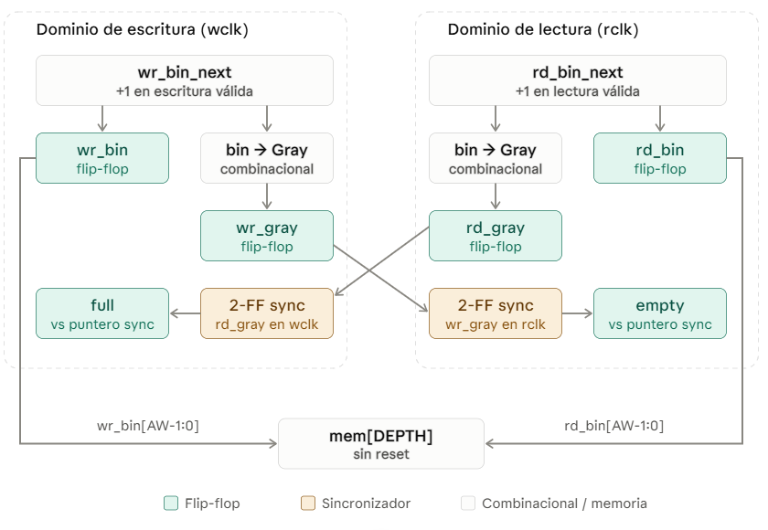

# Exercise: Asynchronous FIFO Design in SystemVerilog

## 1. Objective

Design and verify an Asynchronous FIFO in SystemVerilog to transfer data safely between two independent clock domains.

The FIFO must allow a producer operating in one clock domain to write data and a consumer operating in another clock domain to read data, without assuming any phase or frequency relationship between the two clocks.

The main goal is to implement a reliable CDC architecture using Gray-coded pointers and synchronizer registers.

## 2. Design Specifications

Implement a parameterizable asynchronous FIFO with the following parameters:

| Parameter | Description | Default |
|---|---|---|
| `DATA_WIDTH` | Data width in bits | 8 |
| `DEPTH` | FIFO depth | 16 |

### Interface

| Signal | Direction | Description |
|---|---|---|
| `wr_clk` | Input | Write clock |
| `rd_clk` | Input | Read clock |
| `wr_rst_n` | Input | Write Active-low reset |
| `rd_rst_n` | Input | Read Active-low reset |
| `wr_en` | Input | Write enable |
| `wr_data` | Input | Input data |
| `full` | Output | FIFO full flag |
| `rd_en` | Input | Read enable |
| `rd_data` | Output | Output data |
| `empty` | Output | FIFO empty flag |

## 3. Functional Requirements

### Write Logic
- Accept new data when `wr_en` is asserted and `full` is deasserted.
- Update the write pointer only after a successful write.
- Store data in the FIFO memory using the write clock.
- Prevent writes when the FIFO is full.

### Read Logic
- Read data when `rd_en` is asserted and `empty` is deasserted.
- Update the read pointer only after a successful read.
- Prevent reads when the FIFO is empty.

### Clock Domain Crossing
- Use binary pointers for memory addressing.
- Convert binary pointers to Gray code before synchronizing them across clock domains.
- Synchronize the Gray-coded write pointer into the read clock domain.
- Synchronize the Gray-coded read pointer into the write clock domain.
- Use two-stage synchronizer registers for each pointer crossing.

